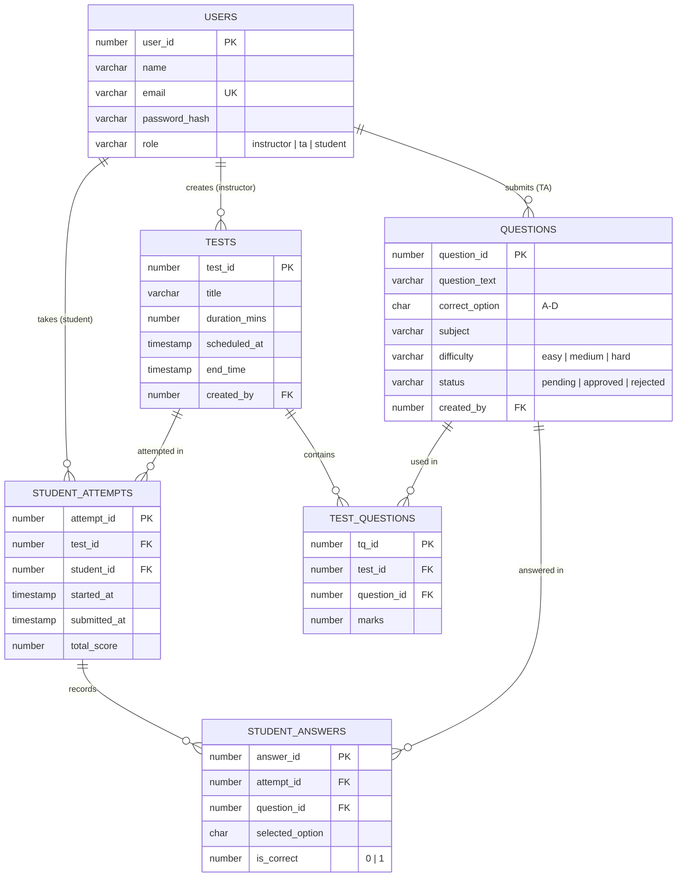

# Online MCQ Test Management System

A database-driven system for running multiple-choice exams from start to finish. Teaching assistants submit
questions to a shared bank, instructors approve them and build timed tests, and students take the tests
inside a scheduled window. Every answer is graded by the database as it is inserted, and SQL reports produce
leaderboards, scorecards and question-level analytics.

The core logic is in **Oracle SQL and PL/SQL**: a normalised schema, stored procedures and functions, and
triggers that enforce the workflow rules.

Built as the mini project for the Database Systems Lab (CSS 2212) at Manipal Institute of Technology, 2026.

## Workflow

1. **Contribute:** a TA adds a question with four options, subject and difficulty. It starts as `pending`.
2. **Approve:** an instructor approves or rejects it (`approve_question`).
3. **Create:** an instructor creates a test with a time window (`create_test`) and adds approved questions
   with marks. A trigger blocks unapproved questions.
4. **Attempt:** a student starts the test. A trigger rejects attempts before the window opens, after it
   closes, or by anyone who isn't a student.
5. **Grade:** each answer is graded on insert, and the attempt's total score is updated at once.
6. **Submit:** `submit_test` records the submission and warns if it is past the deadline.
7. **Report:** queries for leaderboards, scorecards, averages and question performance.

## Schema



Integrity is enforced with primary and foreign keys, `CHECK` constraints (roles, options, status, marks,
test window), and `UNIQUE` constraints so a question appears once per test, a student attempts a test once,
and each question is answered once per attempt.

## PL/SQL

| Object | Type | What it does |
|--------|------|--------------|
| `trg_auto_score` | trigger | Grades each answer on insert, sets `is_correct` and adds the marks to `total_score` |
| `trg_validate_attempt` | trigger | Allows attempts only by students and only inside the test window |
| `trg_check_question_approved` | trigger | Only approved questions can be added to a test |
| `approve_question` | procedure | Instructor approves or rejects a question |
| `create_test` | procedure | Instructor creates a test and gets its id back |
| `submit_test` | procedure | Records the submission and warns when it is late |
| `get_student_score` | function | A student's score on a test |
| `get_test_max_marks` | function | Maximum marks available in a test |

## Running it

Needs Oracle Database 12c or later (it uses identity columns and `STANDARD_HASH`).

With SQL*Plus or SQLcl, from this folder:

```sql
@run_all.sql
```

With [Oracle Live SQL](https://livesql.oracle.com) or another web console, run the files in `sql/` in order.

| File | Contents |
|------|----------|
| `sql/01_schema.sql` | Tables and constraints (drops existing ones first) |
| `sql/02_plsql.sql` | Functions, procedures and triggers |
| `sql/03_sample_data.sql` | 8 users, 6 questions, 3 tests, 4 graded attempts |
| `sql/04_queries.sql` | Reports: leaderboard, scorecards, averages, question performance |
| `sql/05_demo.sql` | Each rule being enforced (rolled back at the end) |

### Expected output

Leaderboard for the DBMS mid-semester test:

```
TITLE                    NAME            TOTAL_SCORE  RANK
DBMS Mid-Semester Test   Sneha Student             9     1
DBMS Mid-Semester Test   Rahul Student             7     2
DBMS Mid-Semester Test   Arjun Student             4     3
```

Attempting a test before it opens:

```
ORA-20004: Test has not started yet.
```

## Team

- Giridhar Sreekumar
- Yash Ghildiyal
- Hrishit Tiwari

School of Computer Engineering, Manipal Institute of Technology, MAHE.
